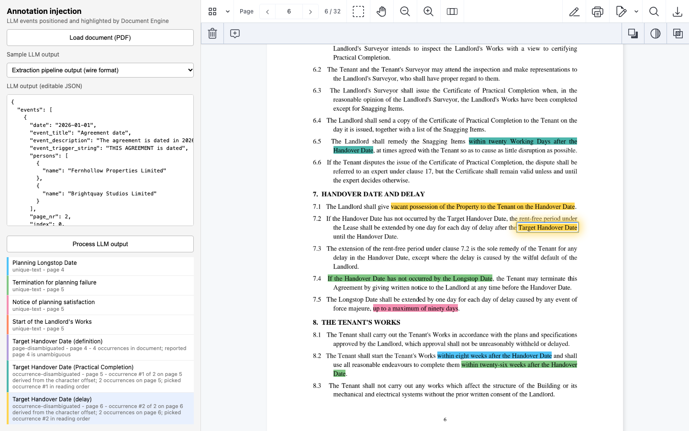
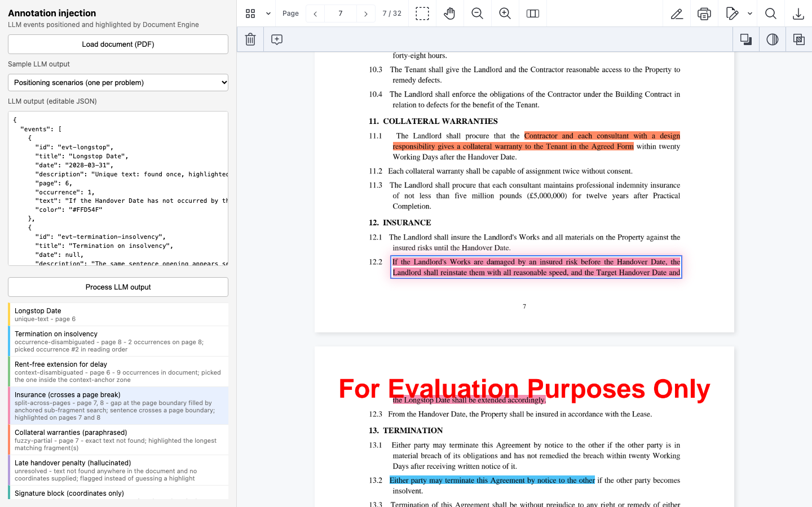

# Nutrient Annotation Injection

A Nutrient.io demo that takes the events an LLM extracted from a long contract (a date, a deadline, a clause, with the text it was found in) and highlights each of them at the right place in the PDF, on the server, with Nutrient Document Engine.



1. **LLM output.** The extraction pipeline sends a list of events. Each event carries the text the LLM quoted (the trigger), and usually a page number and an occurrence number or a character offset. LLM text is not always verbatim, and the same phrase can appear many times in a contract.
2. **Search.** The Node server searches every trigger with the Document Engine search API (`GET /api/documents/:id/search`). Document Engine returns the hits with their rectangles on the page.
3. **Pick the right hit.** When a phrase occurs more than once, the server picks one with, in this order: the page, the occurrence number on that page, the character offset (mapped onto Document Engine's page text), the surrounding text (context), or coordinates sent by the pipeline.
4. **Recover imperfect text.** A trigger that is not found is split in halves at word boundaries and each half is searched again. A sentence cut by a page break is found on both pages, and the words around the break are filled in between the two anchors. A whitespace-tolerant match against the page text covers text-layer defects.
5. **Inject.** Every event becomes one highlight per page (`pspdfkit/markup/highlight`) with the event colour, created in one batch call to the Document Engine annotations API. The method used to place each event is stored in the annotation `customData`.
6. **Review.** The Web SDK viewer shows the document with the server-side annotations. Each event of the list shows how it was placed. Clicking it jumps to the highlight. An event whose text cannot be found anywhere is flagged as unresolved instead of highlighting a wrong passage.

Everything that touches the document happens on the server. The browser only renders it.

## Prerequisites

- Docker Desktop with at least 4 GB of memory
- Node.js 22 or later and npm
- OpenSSL, to generate the local keys
- Free ports 4130 (app) and 5130 (Document Engine), or other ports set in `.env`
- Python 3.10 or later, only to regenerate the samples

## Environment variables

Copy `.env.example` to `.env`. Docker Compose and the Node server read it. License keys are only read from environment variables, never from code.

| Variable | Purpose | Default |
|---|---|---|
| `ACTIVATION_KEY` | Document Engine activation key or offline license key | empty = evaluation mode |
| `WEB_SDK_LICENSE_KEY` | Web SDK license key, served to the browser by `GET /api/viewer-config` | empty = evaluation mode |
| `POSTGRES_PASSWORD` | Local PostgreSQL password used by Document Engine | `change-me`, change it |
| `DASHBOARD_PASSWORD` | Document Engine dashboard password (<http://localhost:5130/dashboard>, user `dashboard`) | `change-me`, change it |
| `APP_PORT` | Port of the Node server | `4130` |
| `DOCUMENT_ENGINE_PORT` | Host port of Document Engine. The browser loads the pages from it | `5130` |

In evaluation mode, Document Engine shows a watermark on every page. Everything else works.

`scripts/generate-keys.sh` writes the other secrets to `keys/`, which is not committed:

| File | Content |
|---|---|
| `keys/jwt-private.pem` | RSA key the server uses to sign the viewer JWT |
| `keys/jwt-public.pem` | Matching public key |
| `keys/document-engine.env` | `JWT_PUBLIC_KEY`, `API_AUTH_TOKEN` and `SECRET_KEY_BASE` for Document Engine |
| `keys/app.env` | `DE_API_TOKEN` for the Node server, the same value as `API_AUTH_TOKEN` |

## Build and run

```bash
cp .env.example .env
```

```bash
./scripts/generate-keys.sh
```

```bash
docker compose up -d
```

```bash
cd server
```

```bash
npm install
```

```bash
npm start
```

Open <http://localhost:4130>. On its first start, the server uploads `documents/sample-agreement-for-lease.pdf` to Document Engine.

To stop and remove the containers and the database:

```bash
docker compose down -v
```

## Using the app

1. **Pick a payload.** **Sample LLM output** has two payloads. The JSON is editable: change a page, an occurrence number or a quote and process it again.
   - **Extraction pipeline output (wire format)**: 43 events as an extraction pipeline sends them, with `event_trigger_string`, a 0-based `page_nr` and the character offset `startIndex` of the trigger in the page text.
   - **Positioning scenarios**: one event per positioning problem, in the PoC's own format (1-based `page`, `occurrence`, `context`, `coordinates`).
2. **Process.** Click **Process LLM output**. The server deletes its previous highlights, places every event and injects the new highlights. The viewer opens again with them.
3. **Check each event.** The list shows how each event was placed and why. Click an event to jump to its highlight. Click it again to go to its next part when it spans two pages.

   

4. **Your own document.** **Load document (PDF)** uploads another PDF to Document Engine and makes it the current document. Paste the LLM output for it in the editor.

Add `?mode=standalone` to the URL to render the document in the browser with WebAssembly instead of server-backed. The highlights are then fetched once as Instant JSON.

### Placement methods

| Method | Meaning |
|---|---|
| `unique-text` | The trigger occurs once in the document |
| `page-disambiguated` | Several occurrences, one on the reported page |
| `occurrence-disambiguated` | Several occurrences on the reported page, picked by the occurrence number, or by the number derived from the character offset |
| `context-disambiguated` | Picked by the surrounding text sent with the event |
| `coordinate-disambiguated` | Picked as the hit closest to the coordinates sent with the event |
| `split-across-pages` | The sentence crosses a page break; highlighted on both pages |
| `fuzzy-partial` | The LLM paraphrased; the longest matching fragments are highlighted |
| `tolerant-match` | Found in the page text despite a whitespace defect in the text layer; the zone is estimated from the text lines |
| `coordinates-fallback` | Text not found; a rectangle is drawn at the coordinates sent with the event |
| `unresolved` | Text not found and no coordinates: nothing is highlighted, the event is flagged |

## Event format

The server accepts `{ "events": [...] }`, `{ "data": [...] }` or a bare array. Each event can use either set of field names:

| Field | Pipeline wire format | Description |
|---|---|---|
| `text` | `event_trigger_string` or `trigger` | The quoted text to highlight |
| `page` (1-based) | `page_nr` (0-based) | Page where the LLM found it |
| `occurrence` | | Occurrence number on that page, in reading order |
| `startIndex` | `startIndex` | Character offset of the trigger in the page text |
| `context` | | `{ "before": "...", "after": "..." }` text around the trigger |
| `coordinates` | | `{ left, top, width, height }` in PDF points, used as a last resort |
| `title`, `description`, `date`, `color` | `event_title`, `event_description`, `date` | Shown in the list |

`nAppereance` in the wire format counts the events emitted per trigger string, not the position of the occurrence in the document, so it is ignored.

## API

| Method and path | Description |
|---|---|
| `GET /api/payloads` | The sample payloads |
| `GET /api/llm-output?payload=pipeline` | A sample payload (`pipeline` or `scenarios`) |
| `POST /api/process` | Places and injects the events of the JSON body. Returns each event with its method, notes, pages, bounding boxes and annotation ids |
| `GET /api/events` | The result of the last processing |
| `POST /api/upload-document?name=x.pdf` | Raw PDF body. Uploads it to Document Engine and makes it the current document |
| `GET /api/viewer-config` | Document Engine URL, document id, a 24-hour viewer JWT and the Web SDK license key |
| `GET /api/document.pdf`, `GET /api/instant-json` | The PDF and the injected highlights, for the standalone viewer |

## Samples

`documents/sample-agreement-for-lease.pdf` is a fictitious 32-page agreement for lease. Every party, property, person and figure in it is invented. The two payloads in `samples/` were measured on it: the page numbers and character offsets come from the PDF text layer, the way a pipeline measures them on its own text. To regenerate the PDF and the payloads:

```bash
pip install -r samples/requirements.txt
```

```bash
python samples/generate_contract.py
```

After regenerating, delete the document in Document Engine (or run `docker compose down -v`) so that the server uploads the new version.

## Files

| Path | Content |
|---|---|
| `server/server.js` | Search, hit selection, gap filling, annotation injection, API |
| `web/` | JSON editor, event list and Web SDK viewer |
| `docker-compose.yml` | Document Engine 1.19.0 and PostgreSQL |
| `scripts/generate-keys.sh` | JWT key pair and API token for the local setup |
| `documents/` | The sample contract |
| `samples/` | Sample payloads and their generator |
